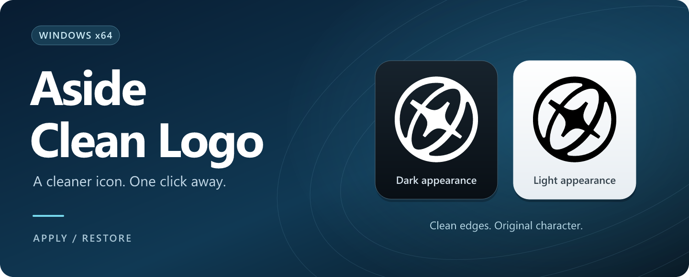
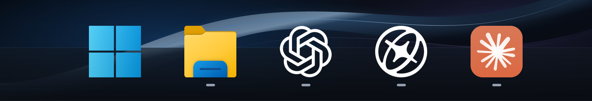

# Aside Clean Logo

**어사이드 아이콘을 더 깔끔하게. 변경도, 원복도 한 번 실행으로.**

Windows의 바탕화면과 작업표시줄에 테두리 없는 로고를 적용합니다. 다크·라이트 모드에 맞춰 색상을 바꾸고, 언제든 원래 로고로 돌아갈 수 있습니다.

  

  
  

**Windows 64비트 · Aside 설치 필요 · 관리자 승인 필요**

설치 마법사와 완료 확인창 없이 작동합니다. [릴리스와 파일 검증 정보](https://github.com/contentriumkorea/aside-clean-logo/releases/latest)

## 깔끔하게 바꾸고, 간단하게 되돌리세요

| 기능 | 동작 |
| --- | --- |
| 원클릭 변경 | 바탕화면·시작 메뉴·고정 작업표시줄·실행 중인 Aside 창의 아이콘을 변경합니다. |
| 테마 자동 전환 | 다크 모드에는 화이트, 밝은 모드에는 블랙 로고를 사용합니다. |
| 원래 로고 복원 | 최초 원본 백업으로 복원하고 이 도구의 도우미와 자동 실행을 제거합니다. |
| 익숙한 Aside 그대로 | 로고의 원래 형태를 유지하며, 브라우저 본체와 로그인·북마크·방문 기록을 변경하지 않습니다. |

## 작업표시줄에서 이렇게 보입니다

*고해상도로 재구성한 디자인 미리보기입니다. 실제 화면 캡처가 아니며, 크기와 배경은 Windows 설정에 따라 달라집니다.*

## 사용 방법

1. 위의 **로고 변경 다운로드**에서 파일을 받아 실행합니다.
2. Windows 관리자 승인창에서 승인하면 자동으로 적용됩니다.
3. 되돌릴 때는 **원래 로고로 복원** 파일을 실행합니다.

테마 전환과 Aside 재실행 후에도 로고를 유지하도록 작은 도우미가 백그라운드와 로그인 시에 동작합니다. **원복하면 함께 제거됩니다.** 앱 목록에는 별도 프로그램을 등록하지 않습니다.

평소 Aside를 사용하는 동일한 관리자 계정으로 실행하세요. .NET Framework 4.8이 필요합니다. 기존 Setup 버전을 쓰고 있어도 원클릭 변경 파일로 전환할 수 있습니다.

[자세한 사용법·문제 해결](docs/usage.md) · [로고 제작 기준](docs/artwork.md) · [개발·검증 문서](windows/README.md)

---

콘텐츠리움이 제작한 비공식 Windows 사용자화 도구입니다. Aside와 제휴한 제품은 아닙니다. Aside를 비롯한 표시된 브랜드의 이름과 로고는 각 권리자에게 있으며, 소스 코드에만 [MIT 라이선스](LICENSE)가 적용됩니다.

